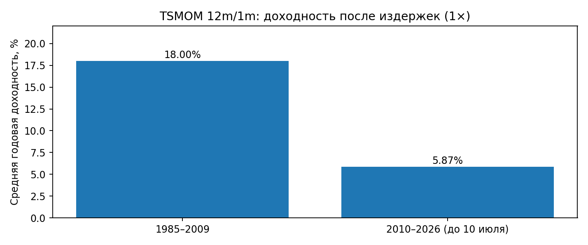
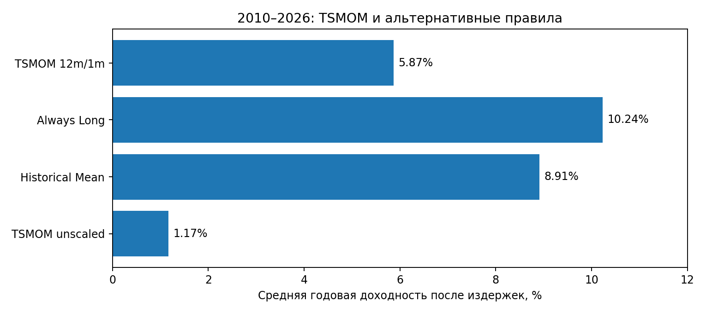

# Может ли 12-месячный тренд предсказывать доходность? 84 фьючерсных рынка

**Quant Research №2 — Time-Series Momentum (12m/1m)**  
**Завершено 14 октября 2026 · Frozen v0.2 · CLOSED: не подтверждён уникальный predictive edge**

**Коротко:** стратегия Time-Series Momentum из академической литературы остаётся прибыльной на нашей исторической выборке 84 фьючерсов после модельных издержек. Но этот факт ещё не доказывает, что именно 12-месячный тренд предсказывает будущую доходность: при сопоставимом масштабировании риска простые контроли **Always Long** и **Historical Mean** показали лучшие результаты.

## Навигация

- [Исследовательский вопрос и ключевой вывод](#исследовательский-вопрос)
- [Результаты и сравнение с контролями](#результаты)
- [Все 13 таблиц в нормальном Excel](results/TSMOM_Results_Reader.xlsx)
- [Результаты: описание и исходные CSV](results/README.md)
- [Документация на русском языке](docs/README.md)
- [Исходный протокол до результатов (русский перевод)](docs/Quant_Research_2_TSMOM_Protocol_v0_2.md)
- [Итоговый отчёт на русском языке](docs/Quant_Research_2_TSMOM_Final_2026-10-14.md)
- [Проверка воспроизводимости](docs/REPRODUCTION_AUDIT.md)
- [Как повторить расчёт](#воспроизведение)

## Исследовательский вопрос

Проверяется известный академический **Time-Series Momentum** (Moskowitz, Ooi & Pedersen): если прошлый 12-месячный excess return инструмента положителен, занять LONG на следующий месяц; если отрицателен — SHORT. Портфель диверсифицирован по фьючерсам, масштабирующимся по доступной на момент решения оценке волатильности. Без подбора lookback, стопов и фильтров после просмотра результатов.

**Наш более строгий вопрос:** даёт ли *сам знак 12-месячного прошлого изменения* устойчивое преимущество, если сравнить его с простыми правилами, не требующими 12-месячного предсказания?

Набор включает 84 контракта (состав доступных рынков меняется) за 1959–10.07.2026. Ключевое сравнение — период **2010–10.07.2026** после оригинальной публикации исследования. Исторический период 1985–2009 даётся для контекста.

## Результаты

**Средняя годовая арифметическая доходность после базовых модельных издержек (1×):**

| Модель | 1985–2009 | 2010–2026 | Sharpe 2010–2026 |
|---|---:|---:|---:|
| **TSMOM 12m/1m, scaled** | **+18,00%** | **+5,87%** | **0,479** |
| **Always Long, same volatility scaling** | — | **+10,24%** | **0,651** |
| **Historical Mean, same scaling** | — | **+8,91%** | **0,637** |
| **TSMOM без volatility scaling** | — | **+1,17%** | **0,225** |



*Рисунок 1. Модельная средняя годовая арифметическая доходность 12m/1m TSMOM после базовых модельных издержек (1×). Период 2026 неполный, по 10 июля.*



*Рисунок 2. Модельная средняя годовая доходность 2010–2026 после базовых издержек (1×); контролям дано сопоставимое волатильностное масштабирование. Результаты не являются реально исполненными сделками.*

### Что выдержало проверку

- Стратегия осталась **положительной** в 2010–2026: +5,87% в год, Sharpe 0,479, CAGR 5,25%, MaxDD −20,45%.
- При **3× модельных издержках**: +4,41% в год, Sharpe 0,36.
- Bootstrap 12-месячными блоками для самостоятельной современной доходности: 95% интервал **+0,59%…+11,97%**.
- 60 из 84 рынков в индивидуальном тесте имели положительную среднюю доходность (но медианный Sharpe контракта слабый).

### Что не выдержало проверку

- **Always Long** и **Historical Mean** оказались сильнее в доходности и Sharpe на том же наборе данных. Парные bootstrap-интервалы различий **не подтверждают** превосходства TSMOM.
- В 2010–2026 вклад LONG до расходов около **+8,51% в год**, SHORT **−1,91%**: результат несимметричен.
- Волатильностное масштабирование критично: без него +1,17% в год.
- 2020–2026: +5,29% в год, но **без 2022 года** +1,21%, а 2023–2026 около нуля.

**Вердикт: положительная историческая доходность портфеля ≠ доказанная самостоятельная предсказательная сила 12-месячного сигнала.**

## Ограничения

Это тест **исторического модельного портфеля**, а не обещание биржевой доходности. Данные взяты из пакета внешних исследователей, не реконструированы заново из исходных котировок бирж. Есть потенциальная зависимость от ретроспективно выбранного набора контрактов, от модели costs, rolling futures и модели волатильности. Средняя валовая экспозиция современной портфельной симуляции около **8,3×**; не моделировались все ограничения по марже, капитальным затратам, проскальзыванию в конкретной инфраструктуре и налогам. Исследование не утверждает, что любая версия трендследования бесполезна.

Подробнее: [полный отчёт](docs/Quant_Research_2_TSMOM_Final_2026-10-14.md).

## Воспроизведение

Нужен **Python 3.10+** и доступ к интернету **один раз** для получения проверенной версии данных. Код исходного расчёта лежит в [`research/original/`](research/original/) и сохранён без изменений; `scripts/run_research.py` запускает копии со скорректированными файловыми путями, без изменения математических правил.

```bash
python -m pip install -r requirements.txt
python scripts/fetch_data.py
python scripts/run_research.py
python scripts/reproduce_signal_robustness.py
python scripts/verify_reproduction.py
python -m unittest discover -s tests -v
```

В `results/` лежат **неизменённые исходные архивные CSV** от 14 октября, а новый запуск пишет в `generated/reproduction/`. Изображения и Excel — редакционные представления тех же опубликованных данных.

**Важно:** из 14 исходных наборов результатов один вспомогательный файл `signal_definition_robustness.csv` не соответствует формату выходного файла приложенного оригинального скрипта. Мы **не скрыли** несоответствие: см. [аудит воспроизводимости](docs/REPRODUCTION_AUDIT.md) и отдельный восстановленный скрипт.

## Источники

- Moskowitz T.J., Ooi Y.H., Pedersen L.H. (2012), *Time Series Momentum*, *Journal of Financial Economics*, 104(2), 228–250: https://doi.org/10.1016/j.jfineco.2011.11.003
- Artur Sepp, Vladimir Lucic. *The Science and Practice of Trend-Following Systems*; публичный пакет с данными `trendfollowing==1.3.1`: https://pypi.org/project/trendfollowing/1.3.1/
- Huang, Li, Wang, Zhou (2020), critique / historical-mean control — см. frozen протокол; сравнение не основано на перепубликации чужого кода.

## Структура репозитория

- `research/original/` — неизменённые Python-скрипты Phase 2, Phase 2 extra, reference core;
- `docs/` — русские версии протокола, AQR Phase 1 и итогового отчёта, аудит; в `docs/original_en/` — неизменённые английские оригиналы;
- `results/` — подлинные машинные CSV плюс полноценная Excel-книга со всеми 13 таблицами на отдельных листах;
- `figures/` — графики по опубликованным архивным данным;
- `scripts/` — безопасное получение данных, переносимый повторный запуск, независимая сверка;
- `tests/` — офлайн проверки архивных результатов.

---

**Краткое резюме на английском (для международных читателей).** We tested a frozen, monthly 12-month lookback / 1-month holding time-series momentum rule on an externally supplied panel of 84 futures contracts. Post-2009 net arithmetic annualized return was +5.87% (Sharpe 0.479), but matched volatility-scaled always-long and historical-mean control portfolios did better. The trend signal’s unique predictive edge was **not established**. We publish original code, archived results, reproducibility scripts and documented limitations.
